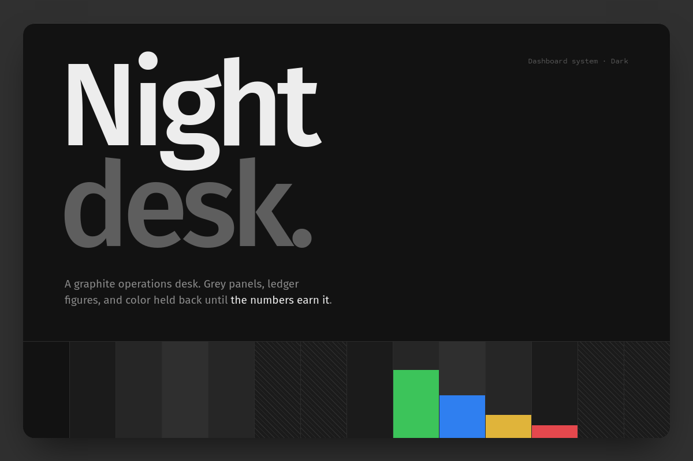
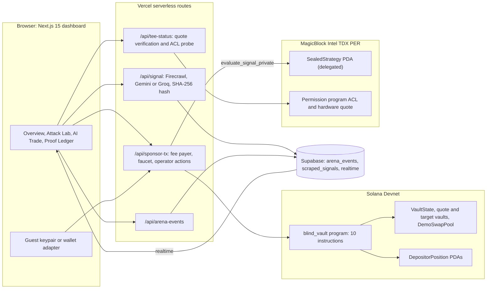
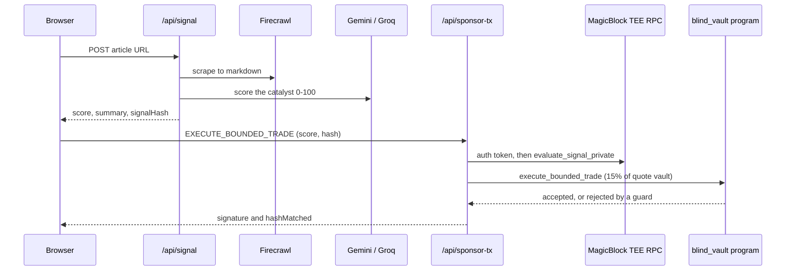

<div align="center">



# Blind Vault

**A hedge fund you can verify, not see.**

Strategy parameters sealed in a MagicBlock Intel TDX enclave. Custody and risk limits enforced by an Anchor program on Solana.

[Live demo](https://blind-vault-main.vercel.app) · [Program on Explorer](https://explorer.solana.com/address/6pDCJuSSzoQCJLtySBf5DqEkSmoFBSDExzjmxWsaDD5N?cluster=devnet) · Demo video: _(add link before submitting)_

  

</div>

---

## Contents

1. [What it is](#1-what-it-is)
2. [Try it in two minutes](#2-try-it-in-two-minutes)
3. [Links and addresses](#3-links-and-addresses)
4. [Architecture](#4-architecture)
5. [The on-chain risk firewall](#5-the-on-chain-risk-firewall)
6. [The confidential strategy (MagicBlock PER)](#6-the-confidential-strategy-magicblock-per)
7. [AI signal pipeline](#7-ai-signal-pipeline)
8. [Gasless onboarding and the relayer](#8-gasless-onboarding-and-the-relayer)
9. [Realtime Proof Ledger](#9-realtime-proof-ledger)
10. [What is live and what is simulated](#10-what-is-live-and-what-is-simulated)
11. [Run it locally](#11-run-it-locally)
12. [Tests and verification](#12-tests-and-verification)
13. [Before vs. during the hackathon](#13-before-vs-during-the-hackathon)
14. [Honest notes and known limitations](#14-honest-notes-and-known-limitations)
15. [Path to mainnet](#15-path-to-mainnet)
16. [Tech stack, repo layout and credits](#16-tech-stack-repo-layout-and-credits)

---

## 1. What it is

Blind Vault is a non-custodial, share-based trading vault on Solana where the manager's strategy stays private but the manager can never exceed public limits.

**The dilemma it targets**

- **Public on-chain AI funds leak alpha.** Strategy parameters and signals that live in public accounts can be copied or front-run.
- **Private off-chain funds require blind trust.** If the strategy is hidden, depositors have no guarantee the manager will stay inside any limit.

**The approach: separate alpha from custody.**

| Layer | Holds | Enforced by |
| :--- | :--- | :--- |
| Intel TDX enclave (MagicBlock Private Ephemeral Rollup) | The `SealedStrategy` account: trigger scores, target allocation, last signal hash, pending order | Hardware attestation and the MagicBlock permission program (ACL) |
| Solana L1 (Anchor program) | Depositor funds, share accounting, risk limits | Program constraints: any trade that breaks a rule reverts |

Whatever the strategy decides, the program rejects a trade that is too large, targets an unapproved token, replays an old order, or arrives after the breaker has tripped. Depositors can always withdraw.

---

## 2. Try it in two minutes

Open the [live demo](https://blind-vault-main.vercel.app). No wallet is needed: a guest keypair is created in your browser and funded with Demo USDC by the relayer.

1. **Overview.** Switch the terminal block between CLI, Anchor and Explorer and run the command to inspect the deployed program yourself. Click **Verify hardware boundary** to query the MagicBlock TEE and see access refused without credentials.
2. **Deposit.** Deposit Demo USDC in the Vault Position panel. This sends a real Devnet transaction; the Proof Ledger links it on Solana Explorer.
3. **Attack Lab.** Run the probes (operator theft, oversized swap, flash crash, prompt-injected rogue AI). Each one is run against the deployed program through Devnet `simulateTransaction` and shows the returned validator logs. Use the two sliders to find the 20% cap and the -5% breaker yourself.
4. **AI Trade.** Pick a news feed (or paste any article URL). The pipeline scrapes it with Firecrawl, scores it with Gemini or Groq, hashes the signal, and asks the relayer to evaluate and trade within the cap.
5. **Proof Ledger.** Every action streams in realtime via Supabase to every open browser. Expand a row for the forensic record.
6. **Audit strip.** The four-step checklist under the page header tracks which invariants you have exercised.

---

## 3. Links and addresses

| Item | Value |
| :--- | :--- |
| Live demo | https://blind-vault-main.vercel.app |
| Source | https://github.com/MohammedSoliman10/blind-vault |
| Program ID (Devnet) | [`6pDCJuSSzoQCJLtySBf5DqEkSmoFBSDExzjmxWsaDD5N`](https://explorer.solana.com/address/6pDCJuSSzoQCJLtySBf5DqEkSmoFBSDExzjmxWsaDD5N?cluster=devnet) |
| Program deployment tx | [`5Mhb61xy…HF1cYy`](https://explorer.solana.com/tx/5Mhb61xyMrXtccnDTKy7VVbFq3UPTTRgyGYAf1AVEAqNuDqfKL8NBNbM1njqfhSHEqqgLW25emCNET17jRHF1cYy?cluster=devnet) |
| Demo vault PDA | [`811BEdAqhr2aUWo59nZ4JpY84AMrWkrnVgnesBjhDVKp`](https://explorer.solana.com/address/811BEdAqhr2aUWo59nZ4JpY84AMrWkrnVgnesBjhDVKp?cluster=devnet) |
| SealedStrategy PDA (seeds `["strategy", vault]`, delegated to the PER) | [`3JcaKPWwKaRbVYAY178bk42qfqrkKSY2aWu6Y9gwmwG2`](https://explorer.solana.com/address/3JcaKPWwKaRbVYAY178bk42qfqrkKSY2aWu6Y9gwmwG2?cluster=devnet) |
| ACL demonstration account (permissioned on the PER, see [section 6](#6-the-confidential-strategy-magicblock-per)) | [`AAQunvudNxbpcLUz2rbTuV3Z6Ga7PQbni3Q7n6xW275A`](https://explorer.solana.com/address/AAQunvudNxbpcLUz2rbTuV3Z6Ga7PQbni3Q7n6xW275A?cluster=devnet) |
| Quote vault (Demo USDC) | `4YnudEYRaXD3bquPBe1fYLPPBbwgxXuckNucTZtReRnE` |
| Target vault | `2b1ptxtiVBVF6PqJMV6rA7mEo7V5ym7tRotFUPWiKsUL` |
| DemoSwapPool | `47ttsGtGvCqcxKydZWPkzNmfwW6xe8UbuyDMiiQkFwBF` |
| Demo USDC mint | `7vhu7vaAnwXpF1pt2e6o157zaL6jEvsoRN3gqQz6s5i4` |
| Demo target mint (allowlisted) | `hTxJzGpNB9J7KD9s11btBz45bN1Esk6b7NerSfwPDNf` |
| Relayer / operator (strategist and fee payer) | `3a23o9KvE5aiJ9rC5F1BpuzAjrSjL2627QgtKBYzwbrK` |
| MagicBlock TEE validator | `MTEWGuqxUpYZGFJQcp8tLN7x5v9BSeoFHYWQQ3n3xzo` |
| MagicBlock TEE RPC | `https://devnet-tee.magicblock.app` |

Inspect the program yourself:

```bash
solana program show 6pDCJuSSzoQCJLtySBf5DqEkSmoFBSDExzjmxWsaDD5N --url devnet
anchor idl fetch 6pDCJuSSzoQCJLtySBf5DqEkSmoFBSDExzjmxWsaDD5N --provider.cluster devnet
```

---

## 4. Architecture



**An AI trade, step by step**



**Program accounts**

| Account | Seeds | Purpose |
| :--- | :--- | :--- |
| `VaultState` | `["vault", vault_id]` | Strategist, mints, vault token accounts, total shares, cap and breaker settings, 24h window, halt flag, trade nonce |
| `DepositorPosition` | per vault and owner | Share balance of one depositor |
| `SealedStrategy` | `["strategy", vault]` | Trigger scores, target allocation, last signal hash, pending order and nonce |
| `DemoSwapPool` | `["demo_pool", quote_mint, base_mint]` | Constant-product pool the vault trades against on Devnet |

Plus the token accounts: `quote_vault`, `target_vault` and the pool's two vaults. Shares are tracked in `DepositorPosition` accounts, not as an SPL token.

**The 10 instructions**

| # | Instruction | Where it runs | What it does |
| :-- | :--- | :--- | :--- |
| 1 | `initialize_vault` | L1 | Creates the vault, token vaults and the strategy account. Defaults: 20% cap, 5% daily loss limit |
| 2 | `delegate_strategy` | L1 | Delegates the `SealedStrategy` PDA to the MagicBlock TEE validator |
| 3 | `init_and_seal_strategy` | L1 (before delegation in `gate:tee`) | Sets trigger scores and target allocation, marks the strategy private |
| 4 | `evaluate_signal_private` | PER | Takes score and signal hash, stores the hash, sets the pending order (buy, sell or hold) and bumps the nonce |
| 5 | `deposit` | L1 | Transfers Demo USDC in and credits pro-rata shares |
| 6 | `execute_bounded_trade` | Devnet program | Runs the guard checks, then swaps through the demo pool |
| 7 | `withdraw` | L1 | Burns shares and pays out pro-rata. Has no halt check |
| 8 | `undelegate_strategy` | PER to L1 | Returns the strategy account to L1 |
| 9 | `initialize_demo_pool` | L1 | Creates the Devnet constant-product pool |
| 10 | `simulate_market_move` | L1 | Devnet-only strategist helper that trips the halt flag for breaker demos |

---

## 5. The on-chain risk firewall

Every rule below is enforced inside the program, so it holds no matter what the off-chain AI or the operator does. Each one has an exploit test in `tests/blind_vault.spec.ts`.

| Guard | How it works | Error (code) | Test |
| :--- | :--- | :--- | :--- |
| Single-trade cap | `amount <= NAV x max_position_bps / 10,000` (20% by default). NAV is the quote vault plus the target holdings valued at the pool price | `ExceedsMaxPositionCap` (6001) | 4 |
| Token allowlist | The pool's base mint must equal the vault's `approved_target_mint` | `UnapprovedMint` (6002) | 5 |
| Drawdown breaker | If NAV is at least 5% below its rolling 24h high-water mark, the trade is rejected | `DailyDrawdownHalted` (6003) | 6 |
| Halt flag | Once `is_halted` is set, every trade is rejected | `VaultIsHalted` (6000) | 6 |
| Replay protection | The strategy's pending nonce must equal the vault's trade nonce plus one | `InvalidTradeNonce` (6004) | 8 |
| Depositor ownership | `has_one = owner`: only the owner can use a position | `UnauthorizedDepositor` (6005) | 3 |
| Operator-only actions | Strategy and vault operations require the strategist (`has_one = strategist`) | Anchor constraint error | 2 |
| Always-open exit | `withdraw` does not check the halt flag, so depositors can leave during a halt | `InsufficientShares` (6006) if over-asking | 7 |

Anchor custom error codes start at 6000, in the order listed in `programs/blind_vault/src/errors.rs`.

---

## 6. The confidential strategy (MagicBlock PER)

The `SealedStrategy` account is delegated to MagicBlock's Intel TDX Private Ephemeral Rollup (validator `MTEWG…xzo`). `evaluate_signal_private` runs against it inside the PER. Access control uses MagicBlock's permission program: only listed members with a valid enclave auth token can read a permissioned account.

**What the repo verifies against the live enclave** (`npm run gate:tee`, `scripts/gate-tee-connectivity.ts`):

1. Hardware quote verification with `verifyTeeRpcIntegrity` against `devnet-tee.magicblock.app`.
2. JWT auth tokens issued to a strategist and to an outsider.
3. A vault is initialized, its strategy is sealed and delegated to the TEE validator on Devnet.
4. A permissioned account is created with the strategist as its only member and delegated to the TEE validator.
5. Live reads of that account: the strategist's token succeeds, a request with no token returns `null`, and a request with an outsider's token returns `null`.

The ACL demonstration in step 5 runs on a dedicated permissioned account (the `AAQun…` address above), not on the `SealedStrategy` PDA itself. See [section 14](#14-honest-notes-and-known-limitations).

`GET /api/tee-status` re-verifies the hardware quote (cached 60 seconds) and performs an unauthenticated read against the TEE. The Overview shows the result as the enclave status panel.

---

## 7. AI signal pipeline

`POST /api/signal` takes a news URL and returns a catalyst score:

1. **Guardrail.** The URL is checked against an SSRF blocklist (loopback, private ranges, link-local, cloud metadata).
2. **Cache.** A SHA-256 of the normalized URL is looked up in Supabase `scraped_signals` with a 15-minute expiry.
3. **Scrape.** Firecrawl's `/v1/scrape` returns clean markdown. If Firecrawl is not configured or fails, the route continues with placeholder text.
4. **Score.** `gemini-flash-lite-latest` returns a score from 0 (bearish) to 100 (bullish), a confidence and a summary. On a Gemini error (including HTTP 429) it falls back to Groq (`qwen/qwen3.8-27b`). With no model keys at all, a deterministic keyword heuristic is used.
5. **Signal hash.** `SHA-256(score : url : timestamp)`. The hash is cached and sent with the trade request.

The relayer then, when it obtains a TEE auth token, writes the score and hash into the sealed strategy through `evaluate_signal_private`, reads the strategy back, and reports `hashMatched` if the stored `last_signal_hash` equals the one it sent. The hash covers the score, URL and timestamp; it is not a hash of the article text.

---

## 8. Gasless onboarding and the relayer

- **Guest sessions.** A guest keypair is generated in the browser and kept in `localStorage`. Standard Solana wallet adapters also work (Phantom and others).
- **`/api/sponsor-tx`** is the relayer. It:
  - mints Demo USDC to a guest's token account (`GUEST_FAUCET`);
  - co-signs and broadcasts client-built transactions as fee payer, after checking that **every instruction targets an allowlisted program**: the Blind Vault program, System, SPL Token, Associated Token and Compute Budget;
  - performs the operator-only actions (`EXECUTE_BOUNDED_TRADE`, `MARKET_SHOCK`);
  - rate limits requests per IP (10 per minute).
- **Trust model.** The relayer's key (`SPONSOR_KEYPAIR_SECRET`) is the vault's strategist, the fee payer and the faucet authority. That is a demo simplification. The program still bounds what the strategist can do.

Deposits are signed by the guest or wallet for their own transfer; the relayer adds the fee payer signature.

---

## 9. Realtime Proof Ledger

- Supabase tables: `arena_events` (every deposit, withdrawal, probe, trade and exit) and `scraped_signals` (the 15-minute signal cache). Schema in `supabase/migrations/001_initial_schema.sql`.
- Row Level Security is on, with public read access for the live ledger. Writes go through the server with the service role.
- `arena_events` is in the `supabase_realtime` publication. Every open browser receives new events over a WebSocket, and a presence channel counts live sessions.
- Transaction links open Solana Explorer only for real signatures. Events without a real signature link to the program address instead.
- A Vercel cron (`vercel.json`) calls `/api/keepalive` daily so the free Supabase project does not pause. Set `CRON_SECRET` to require a bearer token.

If Supabase is not configured, the app still runs and events stay in the session.

---

## 10. What is live and what is simulated

| Capability | Status |
| :--- | :--- |
| Anchor program, 10 instructions | Deployed on Devnet. 8 exploit tests pass against the compiled program in LiteSVM |
| Deposit, withdraw, emergency exit | Real Devnet transactions built in the app and sent through the relayer |
| On-chain state in the UI | Vault and depositor accounts are read from Devnet and decoded with the Codama-generated client |
| Firecrawl scrape, Gemini and Groq scoring | Real API calls, with the fallbacks described in section 7 |
| AI trade | The relayer gets a TEE auth token, calls `evaluate_signal_private`, then submits `execute_bounded_trade`. If the trade is rejected by a guard, the evaluation is still recorded |
| Attack Lab probes | Crafted instructions are sent to Devnet through `simulateTransaction`. Nothing is persisted. The validator logs are shown next to the guard the program enforces. The guards themselves are proven by the LiteSVM tests |
| Market shock | Runs `simulate_market_move` through `simulateTransaction`, so visitors cannot lock the shared vault. The returned reference is not a transaction signature |
| TEE hardware attestation | Real quote verification against MagicBlock |
| TEE read gating | Verified live by `npm run gate:tee` on a permissioned account |
| Demo USDC, target token, swap venue | Devnet test mints and an in-repo constant-product pool. No real value, no external DEX |

---

## 11. Run it locally

**Prerequisites**

- Node.js 20 or newer (22 or 24 recommended)
- Rust, Solana CLI and Anchor 1.1.2 (only to build the program or run the LiteSVM tests)
- A funded Devnet keypair (only for `gate:tee` and for running your own relayer)

**Install and configure**

```bash
git clone https://github.com/MohammedSoliman10/blind-vault.git
cd blind-vault
npm install            # .npmrc sets legacy-peer-deps=true
cp .env.example .env.local
```

| Variable | Needed for | Notes |
| :--- | :--- | :--- |
| `NEXT_PUBLIC_SOLANA_RPC_URL` | RPC | Defaults to `https://api.devnet.solana.com`. A dedicated RPC is more reliable for demos |
| `NEXT_PUBLIC_PROGRAM_ID` | Program | Defaults to the deployed ID above |
| `NEXT_PUBLIC_MAGICBLOCK_TEE_RPC_URL` | TEE | Defaults to `https://devnet-tee.magicblock.app` |
| `NEXT_PUBLIC_MAGICBLOCK_VALIDATOR` | TEE | Defaults to `MTEWGuqxUpYZGFJQcp8tLN7x5v9BSeoFHYWQQ3n3xzo` |
| `SPONSOR_KEYPAIR_SECRET` | Relayer | Base58 string or JSON byte array. Devnet-funded. It is the strategist, fee payer and faucet authority |
| `DEMO_USDC_MINT`, `DEMO_TARGET_MINT` | Demo tokens | Default to the deployed demo mints |
| `NEXT_PUBLIC_SUPABASE_URL`, `NEXT_PUBLIC_SUPABASE_ANON_KEY`, `SUPABASE_SERVICE_ROLE_KEY` | Ledger and cache | Optional. Run the migration in `supabase/migrations/` first |
| `FIRECRAWL_API_KEY` | Scraping | Optional. Without it the route uses placeholder text |
| `GEMINI_API_KEY`, `GROQ_API_KEY` | Scoring | Set at least one. With none, a keyword heuristic is used |
| `CRON_SECRET` | Cron | Optional bearer secret for `/api/keepalive` |

Firecrawl, Gemini, Groq, Supabase and Vercel Hobby all offer free tiers.

**Run**

```bash
npm run dev            # http://localhost:3000
npm run build          # production build
```

**Build the program and regenerate the client (optional)**

```bash
anchor build
npm run generate:client   # Codama client into lib/solana/generated
```

**Deploy to Vercel.** `vercel.json` sets the install command (`npm install --legacy-peer-deps`) and the daily keepalive cron. Add the environment variables above in the Vercel project settings.

---

## 12. Tests and verification

```bash
anchor build      # produces target/deploy/blind_vault.so, needed by the LiteSVM tests
npm test          # 8 LiteSVM exploit tests against the compiled program
npm run test:api  # API route tests: allowlist, rate limit, SSRF, hashing, cache, Groq fallback, cron auth
npm run gate:tee  # live Intel TDX attestation and ACL gate on Devnet (uses devnet SOL)
npm run build     # type check and production build
```

`gate:tee` reads the strategist keypair from `SOLANA_KEYPAIR_PATH` (see the top of `scripts/gate-tee-connectivity.ts`).

**The 8 LiteSVM tests** (`tests/blind_vault.spec.ts`)

1. Valid lifecycle: deposit, private signal, bounded trade, withdraw
2. Unauthorized strategy modification is rejected
3. Operator cannot drain a depositor's position
4. A 25% trade is rejected by the 20% cap
5. A trade into a non-allowlisted mint is rejected
6. A -6% move trips the breaker, then trades are blocked by `VaultIsHalted`
7. A depositor withdraws 100% while the vault is halted
8. A stale trade nonce is rejected

**API tests** (`tests/api.spec.ts`) cover the relayer's program allowlist and rate limiting, the signal route's SSRF blocking, score range, hash generation, cache hits and Groq fallback, and the keepalive route's auth.

---

## 13. Before vs. during the hackathon

The hackathon runs 27 to 29 November 2026. The repository history is the source of truth; run `git log` to check any line below.

**Built before the hackathon (20 to 26 November 2026)**

| Area | What existed |
| :--- | :--- |
| Anchor program | `programs/blind_vault`: 4 state accounts, 10 instructions, error codes, the guard logic in section 5 |
| Program tests | 8 LiteSVM exploit tests |
| Deployment | Program deployed to Devnet at the ID above |
| TEE integration | Delegation, hardware quote verification and the ACL gate script (`gate:tee`) |
| Typed client | Codama client generation (`scripts/generate-client.ts`) |
| Web app | Next.js 15 dashboard with guest sessions, the sponsor relayer, real Devnet deposit, withdraw, bounded trade and exit flows, the Attack Lab, the AI Trade view, the signal API, the TEE status API, the Supabase ledger and the cron keepalive |
| Interface redesign | Hermes-inspired design system, original generated artwork, responsive layout |
| Planning | Spec Kit artifacts in `specs/` and `.specify/` |

**Built during the hackathon (27 to 29 November 2026)**

<!-- UPDATE ON SUBMISSION DAY: list the work done after kickoff. `git log --since=2026-11-27 --pretty="%h %ad %s" --date=short` prints it. -->

_(List the commits and features added between 27 and 29 November here.)_

---

## 14. Honest notes and known limitations

This is a Devnet proof of concept. These are the points a reviewer should know.

- **Demo assets.** Demo USDC and the target token are test mints. The swap venue is an in-repo constant-product pool, and NAV is valued at that pool's price.
- **The operator is the relayer.** One server-held key is strategist, fee payer and faucet authority. The program bounds it, but this is not a production trust model.
- **What "sealed" means in the demo.** The demo strategy's default parameters (buy at 75, sell at 30, 15% allocation) are in this repository and were written on L1 before delegation, so they are not secret. The demo shows the mechanism: delegation to the enclave, `evaluate_signal_private` inside the PER, and permissioned reads. A real strategy would be sealed with parameters first written inside the enclave.
- **ACL scope.** The live read-gating proof runs on a dedicated permissioned account. The `SealedStrategy` PDA is delegated to the PER, but this repo's scripts do not create a permission for it.
- **AI scoring runs off-chain.** Firecrawl and the model calls run in a Vercel route, not inside the enclave. Only `evaluate_signal_private` (score, hash, pending order) runs in the PER.
- **Breaker semantics.** The drawdown check runs when a trade is attempted and rejects it. The persistent `is_halted` flag is set by the Devnet helper `simulate_market_move`. A production version needs an oracle-driven halt and a governed reset.
- **Withdrawal payout.** `withdraw` pays pro-rata from the quote (USDC) vault only. Value held in the target token is not redeemed by a withdrawal, and share pricing also uses the quote vault. This is a demo simplification.
- **Trade sizing.** The AI trade requests a fixed 15% of the quote vault, which is under the 20% cap. The score decides whether the evaluation is a buy, sell or hold, not the size.
- **Signal hash.** It commits to score, URL and timestamp, not to the article or the model output.
- **Rate limiting** is an in-memory sliding window per serverless instance, so it is best-effort.
- **Attack Lab.** Probes use `simulateTransaction` and show the logs the validator returns. They do not persist state.
- **No audit.** The program has not been audited.

---

## 15. Path to mainnet

Roadmap items, not claims about the current build.

1. **Real DEX routing.** Replace the demo pool with Jupiter CPI routing, with slippage and position limits enforced inside the swap instruction.
2. **Oracles.** Pyth or Switchboard prices for NAV, and oracle-driven circuit breakers that persist the halt and have a governed reset.
3. **Multi-vault factory.** Let managers create vaults with their own cap, drawdown limit, allowlist and fee tiers, while depositors keep sovereign withdrawal rights.
4. **Strategy sealing.** Write strategy parameters for the first time inside the enclave, and put a permission on the strategy account itself.
5. **Multi-enclave trust.** Reduce single-hardware dependence by supporting more than one enclave type.
6. **Audit** before any mainnet deployment.

---

## 16. Tech stack, repo layout and credits

**Stack.** Solana, Anchor 1.1.2 (Rust), MagicBlock Ephemeral Rollups SDK (Intel TDX PER), Next.js 15, React 19, Tailwind CSS, `@coral-xyz/anchor`, `@solana/web3.js`, `@solana/kit` with a Codama-generated client, Solana wallet adapter, Supabase (Postgres and Realtime), Firecrawl, Google Gemini, Groq, LiteSVM, Vercel.

**Layout**

```text
programs/blind_vault/   Anchor program (lib.rs, state.rs, errors.rs)
app/                    Next.js app: page.tsx and API routes
  api/signal            Firecrawl scrape, scoring, signal hash, cache
  api/sponsor-tx        Relayer: faucet, co-signing, operator actions
  api/tee-status        Quote verification and ACL probe
  api/arena-events      Event ingestion
  api/keepalive         Cron ping
components/             Dashboard views and UI primitives
  art/                  Engraved plate and band components
lib/solana/             Program client, guest wallet, IDL, generated Codama client
lib/server/             Relayer helpers, SSRF guard, rate limiter
lib/supabase/           Client and realtime subscriptions
scripts/                gate-tee-connectivity, generate-client, generate-art
supabase/migrations/    Database schema
tests/                  LiteSVM exploit tests and API tests
public/art/             Generated guilloche artwork
specs/ and .specify/    Spec Kit planning artifacts
```

**Interface.** The design follows the Hermes Agent site's structure, rebuilt on the Blind Vault palette: Blue `#2531FF`, White `#FFFFFF` and Onahau `#BFF0FF`, with a red used only for error and halted states. Headings are set in Bluu Next, body text in Excon and data in IBM Plex Mono. The engraved artwork is original and generated by `node scripts/generate-art.mjs`. Details in [`UI-REDESIGN.md`](UI-REDESIGN.md).

**Credits.** Bluu Next by Jean-Baptiste Morizot and Velvetyne (SIL Open Font License 1.1). Excon by Alisa Nowak and Indian Type Foundry (free for commercial use via Fontshare). IBM Plex Mono through Fontsource. The Connect Wallet button is from Uiverse.io by andrei0x309.

**AI assistance.** The project was developed with AI coding assistants using the Spec Kit workflow (see `.specify/` and `specs/`).

**License.** MIT. See [`LICENSE`](LICENSE).
